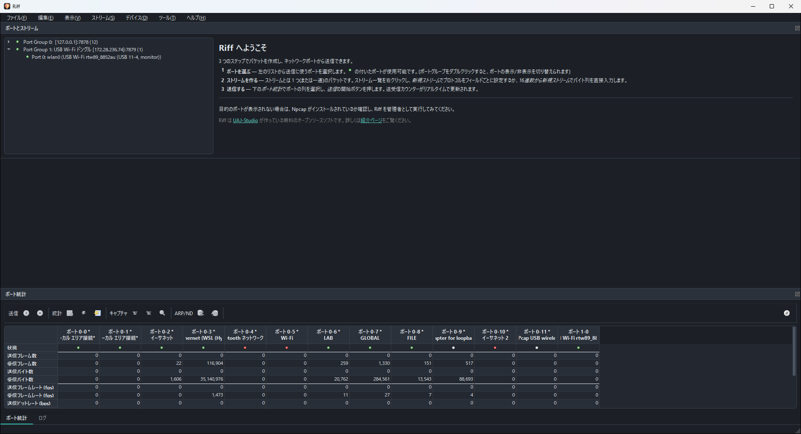
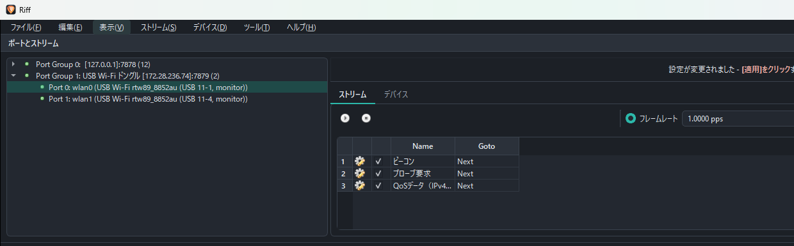
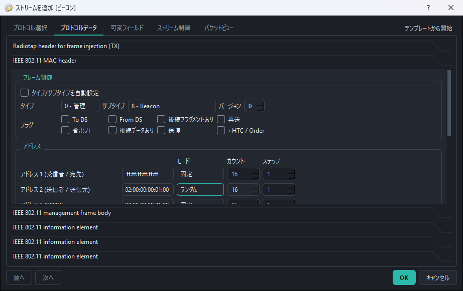

# Riff User Manual

Riff is a packet and traffic generator for Windows. It sends packets you build from wired Ethernet ports and USB Wi-Fi dongles, and captures 802.11 traffic from the dongles live in Wireshark.

[日本語](manual-ja.md) · [Riff page](https://uaj-studio.com/en/riff) · [Download](https://github.com/UAJ-Studio/riff/releases/latest)

## Contents

1. [Installing](#1-installing)
2. [The main window](#2-the-main-window)
3. [Sending packets from wired ports](#3-sending-packets-from-wired-ports)
4. [USB Wi-Fi dongles](#4-usb-wi-fi-dongles)
5. [Live 802.11 capture in Wireshark](#5-live-80211-capture-in-wireshark)
6. [Troubleshooting](#6-troubleshooting)
7. [Use responsibly](#7-use-responsibly)

---

## 1. Installing

### Requirements

- Windows 10 / 11 (64-bit)
- [Npcap](https://npcap.com/) (free): needed to send and receive packets. It may not be redistributed, so it is not bundled; the setup points you to it when it is missing.
- For USB Wi-Fi dongles only: WSL 2 and usbipd-win. The setup can install usbipd-win. To install WSL, run `wsl --install --no-distribution` in an administrator PowerShell and restart the PC.

### Install and update

1. Download `Riff-setup.exe` from the [latest release](https://github.com/UAJ-Studio/riff/releases/latest) and run it.
2. Follow the wizard. No administrator rights are needed (Riff goes to `%LOCALAPPDATA%\Programs\Riff`).
3. For USB Wi-Fi dongles, tick "Install usbipd-win" (an administrator prompt appears).

To update, run the setup of the newer version the same way; settings are kept. If Riff is running, the setup offers to close it.

### Warnings on first start

Riff is not code-signed yet.

- **"Windows protected your PC"** (SmartScreen): choose "More info" → "Run anyway".
- On PCs with **Smart App Control** turned on, Riff does not start until a signed release is available.

### Uninstalling

Settings → Apps → Installed apps → Riff → Uninstall. You are asked whether to:

- give the USB Wi-Fi dongles registered for Riff back to Windows (then they work as normal Wi-Fi adapters again),
- remove Riff's own WSL environment (RiffWireless),
- remove Riff's settings.

Npcap and usbipd-win stay; remove them from Installed apps if you do not need them.

---

## 2. The main window

| Area | What it shows |
|---|---|
| Ports and Streams (top left) | The ports you can send from. `Port Group 0` holds the Windows network adapters (wired Ethernet and others), `USB Wi-Fi dongles` the dongles Riff uses. Ports with a green mark are usable. |
| Streams (top right) | Select a port to see the streams (packets) it sends. At first it shows a short how-to. |
| Port Statistics (bottom) | Packets and rates sent and received per port. Transmit and capture are started and stopped here too. |
| Logs (bottom tab) | What Riff has been doing. |

---

## 3. Sending packets from wired ports

Three steps: pick a port, create a stream, send.

### 3.1 Pick a port

Select the port to send from in the list on the left. If a port is missing, make sure Npcap is installed and try running Riff as administrator.

### 3.2 Create a stream

A stream is one packet (or a series of packets) to send. Right-click the stream list and choose:

- **New Stream**: choose protocols (Ethernet, VLAN, IPv4/IPv6, TCP/UDP, ARP, tunnels, …) and set their fields.
- **New Stream from Hex**: type the bytes of the packet in hex. A hex dump copied from Wireshark can be pasted too.

Both editors have **Start from Template** to create common packets in one click:

| Group | Examples |
|---|---|
| Basic | Ethernet + IPv4 + UDP, TCP SYN, ICMP Echo Request (ping), ARP Request, IPv6 + UDP, with a VLAN tag |
| Tunnels / encapsulation | CAPWAP, EtherIP, VXLAN, Geneve, GRE, IP-in-IP, MPLS, PPPoE, GTP-U |
| Control / applications | DNS Query, DHCP Discover, LLDP, STP BPDU, IGMPv2 |
| Wi-Fi (802.11, for a wireless dongle) | Beacon, Probe Request, Data, QoS Data, Null Data, RTS, CTS, ACK and more |

A packet entered in hex can be turned back into editable protocol fields with **Split the Hex Dump into Protocols** (when Riff can decode it).

### 3.3 How to send

Besides the packet itself, the stream editor sets how it is sent:

- how many packets, or send continuously,
- the rate (for example packets per second),
- changes from packet to packet: counting or random addresses and more.

Streams work as in Ostinato, which Riff is derived from; the [Ostinato website](https://ostinato.org/) has more on them.

### 3.4 Send

1. In Port Statistics at the bottom, select the column of the port.
2. Press the Transmit **start** button (▶); the **stop** button (■) stops it.
3. The counters update live.

The Capture buttons next to it record what the port receives (start / stop capture), and **View Capture Buffer** opens it in Wireshark.

### 3.5 Save

- **File > Save Streams / Open Streams**: the streams of the selected port.
- **File > Save Session / Open Session**: the streams of all ports.

---

## 4. USB Wi-Fi dongles

A USB Wi-Fi dongle sends raw 802.11 frames (beacons, probe requests, …) without joining a network.

### 4.1 How it works

usbipd-win hands the dongle to **Riff's own WSL environment (RiffWireless)**, where a Linux driver runs it.

- Your other WSL distributions and your WSL settings are not changed.
- While Riff uses a dongle, Windows cannot use it as a Wi-Fi adapter (**Give back to Windows** returns it).
- Supported chips: see the [list of supported dongles](https://github.com/UAJ-Studio/riff#supported-usb-wi-fi-dongles).

### 4.2 The Wireless Dongle window

**Tools > Wireless Dongle** has four sections:

| Section | What it does |
|---|---|
| 1. Preparation | The state of WSL, usbipd-win and the Riff wireless environment. If the environment is not installed, press **Set up** (about 70 MB, about a minute). **Update** appears when there is a newer one. |
| 2. Dongle | The USB devices. The Support column tells whether Riff can use a device as a dongle. |
| 3. Transmit (use the dongle as a Riff port) | Choose the country and channel; **Start** makes the dongles Riff ports. |
| 4. Live capture (Wireshark) | Choose a channel and width per dongle and start a capture in Wireshark ([section 5](#5-live-80211-capture-in-wireshark)). |

### 4.3 First use

1. Plug in the dongle.
2. Open **Tools > Wireless Dongle** and **Set up** the Riff wireless environment under "1. Preparation".
3. Under "2. Dongle", select the dongle and press **Register for Riff**. Allow the administrator prompt.
   - A registered dongle is detached from the Windows Wi-Fi driver and kept for Riff.
   - To use it in Windows again, select it and press **Give back to Windows**.
4. Tick the dongles to use.

Registered dongles are readied automatically whenever Riff starts and appear in the main window as `USB Wi-Fi dongles` ports.

### 4.4 Send 802.11 frames

1. Under "3. Transmit", choose the **Country**: transmissions follow its radio rules (channels and power).
2. Choose the **Channel** (it can also be changed per port later).
3. **Start**: the dongles become ports in the main window (for example `wlan0`).
4. Create a stream on that port. **Start from Template** → **Wi-Fi (802.11, for a wireless dongle)** has beacons and more.

The 802.11 header fields can be edited too, for example a random source address.

5. Send as in [3.4](#34-send).

### 4.5 When WSL is updated

A WSL update can bring a new Linux kernel, which needs drivers built for it.

- Riff **downloads** the drivers for the new kernel by itself. They are built automatically, normally within a day after a new kernel appears.
- If they are not available yet or the PC is offline, Riff says so; **Build on This PC** builds them on the PC (needs the Internet, about 10 minutes).
- Wired ports keep working meanwhile.

---

## 5. Live 802.11 capture in Wireshark

What the dongles receive can be shown live in [Wireshark](https://www.wireshark.org/) on Windows. Install Wireshark first.

### 5.1 From Riff

1. Under "4. Live capture (Wireshark)" in **Tools > Wireless Dongle**, tick the dongles to capture with.
2. Choose a **Channel** and **Width** for each. Each dongle can capture a different channel at the same time.
3. **Show in one Wireshark window** puts all dongles in one window (the interface column tells which dongle received a frame); without it, each dongle gets its own window.
4. **Live Capture in Wireshark** opens Wireshark already capturing.

### 5.2 From Wireshark

After the first live capture from Riff, Wireshark's interface list also shows **"Wi-Fi monitor: …"** interfaces, which you can capture from directly. Choose the channel in Wireshark under Capture > Options, with the gear icon of the interface.

### 5.3 Transmitting and capturing at once

A dongle that is also transmitting is retuned to the capture channel. To transmit and capture on different channels, use two dongles.

If Riff cannot find Wireshark, set its location under **Edit > Preferences**.

---

## 6. Troubleshooting

**A port is missing**
Make sure Npcap is installed and try running Riff as administrator.

**A dongle shows as "Not supported"**
Riff has no driver for its chip. See the [list of supported dongles](https://github.com/UAJ-Studio/riff#supported-usb-wi-fi-dongles).

**An AirPcap shows as "Windows capture adapter"**
AirPcap is a capture adapter for Windows; Riff lists it with the wired ports as an AirPcap port and never uses it as a wireless dongle. If it says "give it back to Windows", select it and press **Give back to Windows**.

**A dongle is not readied or does not appear as a port**
- Re-plug it and press **Refresh** in the Wireless Dongle window.
- Riff logs what happens with the dongles to `%LOCALAPPDATA%\Riff\wireless.log`; please attach it when you ask for help.

**Does Riff affect my other WSL distributions?**
It does not change their files or your WSL settings. All WSL 2 distributions share one Linux kernel, though: drivers Riff loads and dongles handed to WSL are visible to the others until `wsl --shutdown`.

**Contact**
[GitHub Issues](https://github.com/UAJ-Studio/riff/issues) or [UAJ-Studio](https://uaj-studio.com).

---

## 7. Use responsibly

- Use Riff only with equipment and networks you own or are allowed to test.
- Transmit only with certified radio equipment, following your country's rules.
- Do not disturb other people's communication.
- Do not disclose or use the contents of other people's communication you receive.

Riff is free and open source (GPLv3). It is derived from [Ostinato](https://ostinato.org) 1.3.0 by Srivats P.; it is not affiliated with or endorsed by the Ostinato project.
