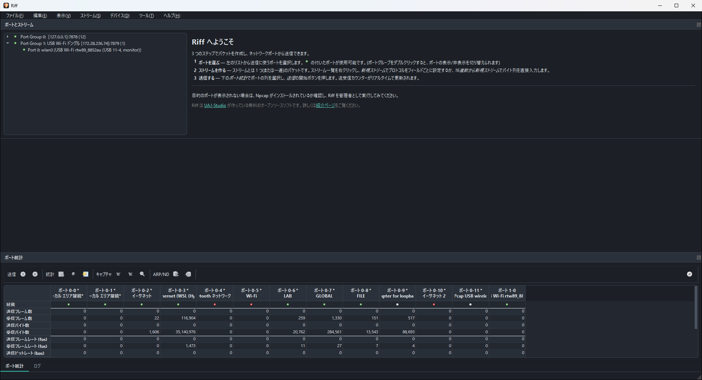
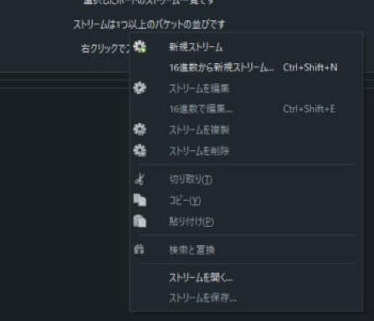
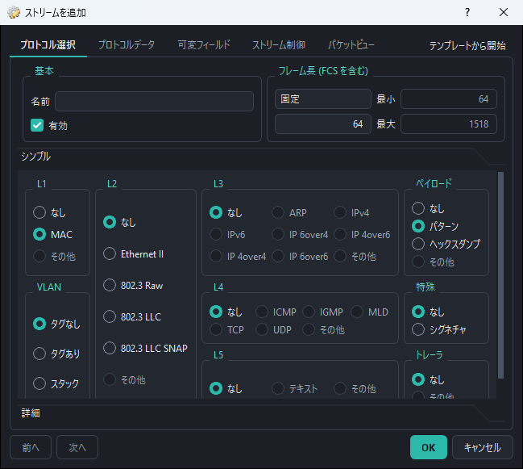
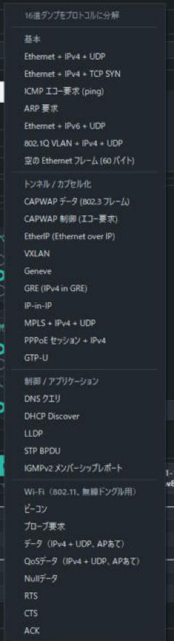
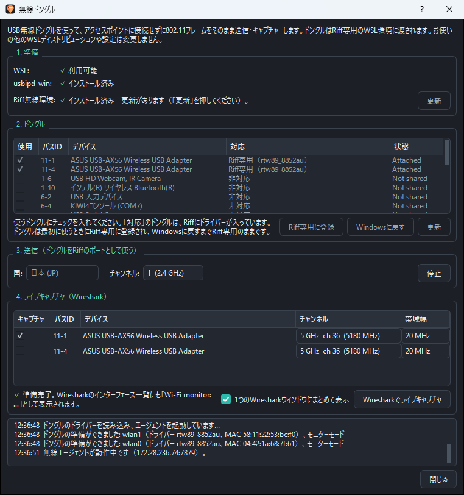
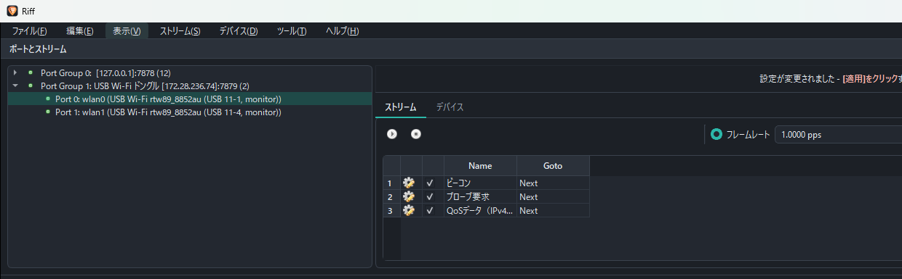
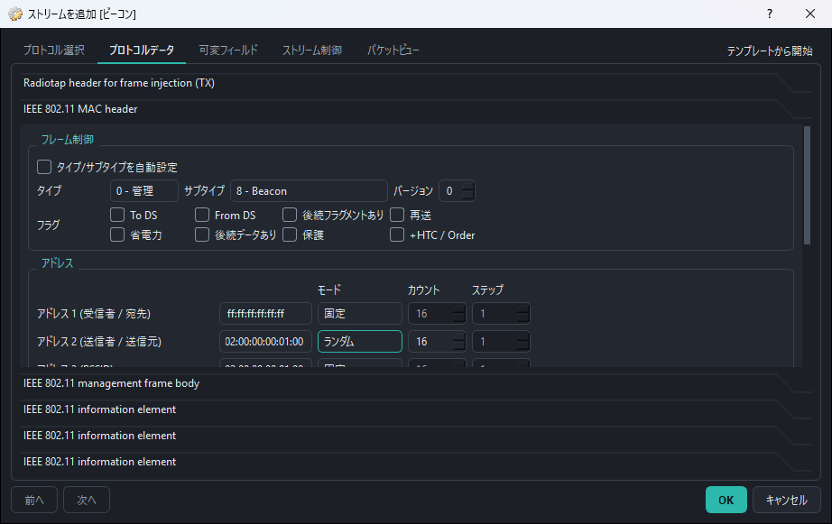

# Riff 使い方マニュアル

Riff は Windows 用のパケット/トラフィックジェネレーターです。有線 LAN と USB Wi-Fi ドングルから自由に作ったパケットを送信でき、ドングルで受信した無線（802.11）を Wireshark でライブキャプチャすることもできます。

[English](manual-en.md) ・ [紹介ページ](https://uaj-studio.com/riff) ・ [ダウンロード](https://github.com/UAJ-Studio/riff/releases/latest)

## 目次

1. [インストール](#1-インストール)
2. [画面の見かた](#2-画面の見かた)
3. [有線 LAN からパケットを送る](#3-有線-lan-からパケットを送る)
4. [USB Wi-Fi ドングルを使う](#4-usb-wi-fi-ドングルを使う)
5. [Wireshark で無線をライブキャプチャする](#5-wireshark-で無線をライブキャプチャする)
6. [困ったとき](#6-困ったとき)
7. [使うときの注意](#7-使うときの注意)

---

## 1. インストール

### 必要なもの

- Windows 10 / 11（64 ビット）
- [Npcap](https://npcap.com/)（無料）：パケットの送受信に必要です。再配布できないため同梱していません。インストールしていないと、Riff のインストーラーが案内します。
- USB Wi-Fi ドングルを使う場合だけ：WSL 2 と usbipd-win。usbipd-win はインストーラーから入れられます。WSL は、管理者の PowerShell で `wsl --install --no-distribution` を実行して PC を再起動すると入ります。

### インストールと更新

1. [最新版のページ](https://github.com/UAJ-Studio/riff/releases/latest)から `Riff-setup.exe` をダウンロードして実行します。
2. 画面に沿って「次へ」で進みます。管理者権限は必要ありません（`%LOCALAPPDATA%\Programs\Riff` に入ります）。
3. USB Wi-Fi ドングルを使う場合は、「usbipd-win をインストールする」にチェックを入れます（管理者の確認画面が出ます）。

**更新**：新しい版が出ると、Riff が起動時に「Riff 〇〇 が出ています」と知らせます。「更新」を押すと、ダウンロードしてから Riff を閉じて更新し、もう一度起動します。設定は残ります。知らせを閉じても、画面右下の「更新」ボタンからいつでも更新できます。

- 「ヘルプ ＞ 更新を確認」で、今すぐ確かめることもできます。
- 確認は 1 日 1 回ほど、GitHub に最新の版番号を問い合わせるだけです。PC や利用者の情報は送りません。止めるときは「ヘルプ ＞ 起動時に更新を確認する」のチェックを外します。
- 新しい版のインストーラーを自分でダウンロードして実行しても、同じように更新できます。

### 初回の起動で警告が出るとき

Riff にはまだコード署名がありません。

- **「Windows によって PC が保護されました」**（SmartScreen）：「詳細情報」→「実行」で起動できます。
- **スマート アプリ コントロール**がオンの PC では、署名入りの版が出るまで起動できません。

### アンインストール

「設定」→「アプリ」→「インストールされているアプリ」→ Riff →「アンインストール」。途中で次のことを聞かれます。

- Riff 専用に登録した USB Wi-Fi ドングルを Windows に戻すか（戻すと、普通の Wi-Fi アダプターとして使えます）
- Riff 専用の WSL 環境（RiffWireless）を削除するか
- Riff の設定を削除するか

Npcap と usbipd-win は残ります。不要なら「インストールされているアプリ」から削除してください。

---

## 2. 画面の見かた

| 場所 | 内容 |
|---|---|
| ポートとストリーム（左上） | 送信に使えるポートの一覧です。`Port Group 0` が有線 LAN などの Windows のネットワークアダプター、`USB Wi-Fi ドングル` が Riff で使っているドングルです。緑の印のポートが使えます。 |
| ストリーム（右上） | ポートを選ぶと、そのポートから送るストリーム（パケット）の一覧になります。起動直後は使い方の案内が出ています。 |
| ポート統計（下） | ポートごとの送受信の数とレートです。送信やキャプチャの開始・停止もここで行います。 |
| ログ（下のタブ） | Riff の動作の記録です。 |

---

## 3. 有線 LAN からパケットを送る

基本は「ポートを選ぶ → ストリームを作る → 送信する」の 3 ステップです。

### 3.1 ポートを選ぶ

左の一覧から、送信に使うポートを選びます。目的のポートが出ないときは、Npcap が入っているか確認し、Riff を管理者として実行してみてください。

### 3.2 ストリームを作る

ストリームとは、送る 1 つ（または一連）のパケットです。ストリームの一覧を右クリックして、作り方を選びます。

- **新規ストリーム**：Ethernet、VLAN、IPv4/IPv6、TCP/UDP、ARP、トンネルなどのプロトコルを選び、フィールドごとに値を設定します。
- **16 進数から新規ストリーム**：パケットのバイト列を 16 進数で直接入力します。Wireshark からコピーした 16 進ダンプも貼り付けられます。

どちらの画面にも **「テンプレートから作成」** があり、よく使うパケットを選ぶだけで作れます。

| 分類 | 例 |
|---|---|
| 基本 | Ethernet + IPv4 + UDP、TCP SYN、ICMP Echo Request（ping）、ARP Request、IPv6 + UDP、VLAN 付き |
| トンネル | CAPWAP、EtherIP、VXLAN、Geneve、GRE、IP-in-IP、MPLS、PPPoE、GTP-U |
| 制御・アプリケーション | DNS Query、DHCP Discover、LLDP、STP BPDU、IGMPv2 |
| Wi-Fi（802.11、無線ドングル用） | ビーコン、プローブ要求、データ、QoS データ、Null Data、RTS、CTS、ACK など |

16 進数で作ったパケットは、**「16 進ダンプをプロトコルに分解」**を選ぶと、フィールドごとに編集できる形に戻せます（分解できる場合）。

### 3.3 送り方を決める

ストリームの編集画面では、パケットの中身のほかに、送り方も決められます。

- 送るパケットの数、または送り続けるか
- 送信レート（1 秒あたりのパケット数など）
- パケットごとの変化：アドレスを 1 つずつ増やす（連番）、ランダムにする、など

ストリームの基本的な操作は、元になった Ostinato と同じです。詳しくは [Ostinato の公式サイト](https://ostinato.org/)も参考になります。

### 3.4 送信する

1. 下の「ポート統計」で、送信したいポートの列を選びます。
2. 「送信」の **開始ボタン**（▶）を押します。止めるときは **停止ボタン**（■）です。
3. 送受信の数がリアルタイムで増えていきます。

同じ場所の「キャプチャ」のボタンで、そのポートの受信を記録し（キャプチャ開始/停止）、「キャプチャバッファを表示」で Wireshark に開けます。

### 3.5 保存する

- **ファイル ＞ ストリームを保存 / ストリームを開く**：選んだポートのストリームを保存します。
- **ファイル ＞ セッションを保存 / セッションを開く**：すべてのポートのストリームをまとめて保存します。

---

## 4. USB Wi-Fi ドングルを使う

USB Wi-Fi ドングルから、アクセスポイントに接続せずに 802.11 の無線フレーム（ビーコン、プローブ要求など）をそのまま送信できます。

### 4.1 しくみ

ドングルは usbipd-win で **Riff 専用の WSL 環境（RiffWireless）** に渡され、そこで Linux のドライバーで動きます。

- Ubuntu など、お使いのほかの WSL 環境や WSL の設定は変更しません。
- ドングルを Riff で使っている間は、Windows からはそのドングルを Wi-Fi として使えません（「Windowsに戻す」で元に戻せます）。
- 対応しているチップは [対応ドングルの一覧](https://github.com/UAJ-Studio/riff#supported-usb-wi-fi-dongles) を見てください。

### 4.2 「無線ドングル」の画面

**ツール ＞ 無線ドングル** を開くと、次の 4 つの欄があります。

| 欄 | 内容 |
|---|---|
| 1. 準備 | WSL、usbipd-win、Riff無線環境の状態です。Riff無線環境が未インストールなら「セットアップ」を押します（約 70MB、1 分ほど）。更新があるときは「更新」と表示されます。 |
| 2. ドングル | USB 機器の一覧です。「対応」の欄で、Riff で使えるドングルかどうかが分かります。 |
| 3. 送信 | 国とチャンネルを選び、「開始」でドングルを Riff のポートにします。 |
| 4. ライブキャプチャ（Wireshark） | ドングルごとのチャンネルと帯域幅を選び、Wireshark でキャプチャを始めます（[5 章](#5-wireshark-で無線をライブキャプチャする)）。 |

### 4.3 初めて使うとき

1. ドングルを PC に挿します。
2. **ツール ＞ 無線ドングル** を開き、「1. 準備」で Riff無線環境を **セットアップ** します。
3. 「2. ドングル」で使うドングルを選び、**Riff専用に登録** を押します。管理者の確認画面が出るので許可してください。
   - 登録すると、そのドングルは Windows の Wi-Fi ドライバーから切り離され、Riff 専用になります。
   - Windows で再び使うときは、選んで **Windowsに戻す** を押します。
4. 使うドングルにチェックを入れます。

一度登録したドングルは、次から Riff の起動時に自動で準備され、メイン画面に `USB Wi-Fi ドングル` のポートとして出ます。

### 4.4 無線フレームを送る

1. 「3. 送信」で **国** を選びます。送信はその国の電波のルール（使えるチャンネルと出力）に従います。
2. **チャンネル** を選びます（ポートごとに後から変えることもできます）。
3. **開始** を押すと、ドングルがメイン画面のポート（例：`wlan0`）になります。
4. そのポートにストリームを作ります。「テンプレートから作成」の **Wi-Fi（802.11、無線ドングル用）** から、ビーコンなどを選ぶと簡単です。

802.11 のヘッダーのフィールドも編集できます。送信元アドレスをランダムにする、といった指定もできます。

5. [3.4](#34-送信する) と同じように送信します。

### 4.5 WSL が更新されたとき

Microsoft が WSL を更新すると、Linux のカーネルの版が変わり、それに合うドライバーが必要になります。

- Riff は、新しいカーネル用のドライバーを **自動でダウンロード** します。ドライバーは、新しいカーネルが出ると通常 1 日以内に自動で作られます。
- まだ用意されていない場合や、インターネットにつながっていない場合は、案内が出ます。**「この PC で作る」** を押すと、PC 上でドライバーを作ります（インターネット接続が必要で、10 分ほどかかります）。
- そのあいだも、有線 LAN のポートはそのまま使えます。

---

## 5. Wireshark で無線をライブキャプチャする

ドングルで受信した無線（802.11）を、Windows の [Wireshark](https://www.wireshark.org/) でそのまま表示できます。Wireshark を先にインストールしておいてください。

### 5.1 Riff から始める

1. **ツール ＞ 無線ドングル** の「4. ライブキャプチャ（Wireshark）」で、キャプチャするドングルにチェックを入れます。
2. ドングルごとに **チャンネル** と **帯域幅** を選びます。ドングルごとに別々のチャンネルを同時にキャプチャできます。
3. **1つのWiresharkウィンドウにまとめて表示** を選ぶと、すべてのドングルの受信を 1 つのウィンドウにまとめます（どのドングルで受信したかはインターフェースの列で分かります）。外すと、ドングルごとに別のウィンドウを開きます。
4. **Wiresharkでライブキャプチャ** を押すと、キャプチャを始めた状態の Wireshark が開きます。

### 5.2 Wireshark から始める

一度 Riff からライブキャプチャを使うと、Wireshark のインターフェース一覧にも **「Wi-Fi monitor: …」** が表示されます。Wireshark から直接選んでキャプチャできます。チャンネルは、Wireshark の「キャプチャ ＞ オプション」で、そのインターフェースの歯車アイコンから選びます。

### 5.3 送信とキャプチャを同時に使うとき

送信に使っているドングルでキャプチャを始めると、そのドングルはキャプチャのチャンネルに切り替わります。送信とキャプチャを別々のチャンネルで行うには、ドングルを 2 本使ってください。

Wireshark の場所が見つからない場合は、**編集 ＞ 設定** で指定できます。

---

## 6. 困ったとき

**目的のポートが表示されない**
Npcap が入っているか確認し、Riff を管理者として実行してみてください。

**ドングルが「非対応」と表示される**
中のチップが Riff のドライバーに入っていません。[対応ドングルの一覧](https://github.com/UAJ-Studio/riff#supported-usb-wi-fi-dongles) を見てください。

**AirPcap が「Windows のキャプチャ機器」と表示される**
AirPcap は Windows で使うキャプチャ機器で、Riff では有線 LAN と同じ一覧に AirPcap のポートとして出ます。無線ドングルとしては使いません。「Windows に戻してください」と表示されている場合は、選んで「Windowsに戻す」を押してください。

**ドングルの準備ができない、ポートに出ない**
- ドングルを挿し直して、「無線ドングル」の画面の **更新** を押してみてください。
- 動作の記録が `%LOCALAPPDATA%\Riff\wireless.log` にあります。問い合わせのときに添えていただくと、原因が分かりやすくなります。

**ほかの WSL 環境に影響はある？**
ほかの WSL 環境のファイルや WSL の設定は変更しません。ただし WSL 2 では、すべての環境が 1 つの Linux カーネルを共有しているため、Riff が読み込んだドライバーや、WSL に渡したドングルは、`wsl --shutdown` するまでほかの環境からも見えます。

**問い合わせ**
[GitHub の Issues](https://github.com/UAJ-Studio/riff/issues) か、[UAJ-Studio のお問い合わせ](https://uaj-studio.com) からお願いします。

---

## 7. 使うときの注意

- 自分が管理する機器・ネットワーク、または許可を得た環境でだけ使ってください。
- 無線の送信には、技適マークのある機器を使ってください。
- 他人の通信を妨害しないでください。
- 受信した他人の通信の内容を漏らしたり、利用したりしないでください（電波法で禁止されています）。

Riff は無料のオープンソースソフト（GPLv3）です。[Ostinato](https://ostinato.org) 1.3.0（Srivats P. 作）をもとにした派生版で、Ostinato プロジェクトとは関係がなく、公認も受けていません。
